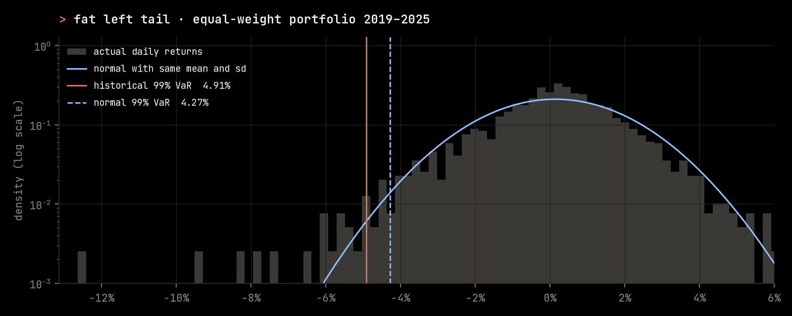
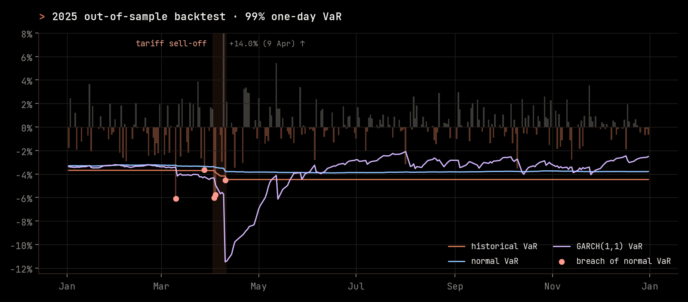
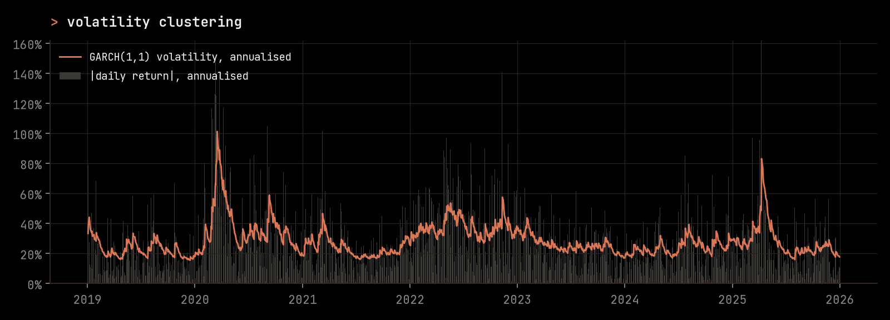

A Python engine that estimates **one-day Value at Risk (VaR)** for an equal-weight portfolio of AAPL, GOOGL, MSFT, TSLA and AMZN using four methods. It then **backtests** each method out of sample through 2025, including the April 2025 tariff sell-off, and uses formal tests to ask whether each model was right.

> **VaR in one line.** A 99% one-day VaR of 4% means: *on 99 days out of 100, the portfolio should not lose more than 4% in a day.* A **breach** is a day when it does.

## Results

Daily prices from Yahoo Finance, 2 Jan 2019 to 31 Dec 2025 (1,759 daily returns). Each forecast uses only the previous 500 trading days.

**1 · Returns have fat tails, so the normal model understates the risk**

| full sample 2019–2025 | historical | normal | gap |
|---|---:|---:|---:|
| 95% one-day VaR | 3.08% | 2.98% | 3% too low |
| 99% one-day VaR | **4.91%** | **4.27%** | **13% too low** |

The portfolio's excess kurtosis is **4.52**; a normal distribution has 0. Large losses happen far more often than the bell curve allows. The further out into the tail you go, the more the normal assumption misses.



**2 · Out-of-sample backtest, 2025 (250 trading days)**

| method | 95% breaches<br>(expect 12.5) | Kupiec p | 99% breaches<br>(expect 2.5) | Kupiec p | independence p |
|---|---:|---:|---:|---:|---:|
| historical simulation | 21 | 0.024 | 4 | 0.380 | **0.043** |
| parametric normal | 19 | 0.079 | 5 | 0.162 | 0.076 |
| Monte Carlo (normal) | 19 | 0.079 | 5 | 0.162 | 0.076 |
| GARCH(1,1) | **15** | **0.481** | 5 | 0.162 | 0.076 |

*Kupiec p:* is the number of breaches consistent with the confidence level? *Independence p* (Christoffersen, at 99%): do breaches arrive in clusters? A small p-value means the model fails that check.



**3 · The April 2025 tariff sell-off**

| date | portfolio return | historical 99% VaR | normal 99% VaR | GARCH 99% VaR |
|---|---:|---:|---:|---:|
| 2 Apr | +1.52% | 3.71% | 3.38% | 4.35% |
| 3 Apr | **−6.02%** | 3.71% | 3.38% | 4.33% |
| 4 Apr | **−5.76%** | 3.88% | 3.44% | 4.95% |
| 7 Apr | −0.70% | 4.17% | 3.51% | 5.69% |
| 8 Apr | −2.97% | 4.17% | 3.51% | 5.57% |
| 9 Apr | +13.96% | 4.17% | 3.52% | 5.71% |
| 10 Apr | **−4.55%** | 4.17% | 3.77% | 11.48% |

Bold rows breached the normal 99% VaR. Every method was breached on both 3 and 4 April: two days in a row, at a level that should be crossed about once every 100 days.

## What this shows

- **The normal assumption is the weak point.** At 99%, normal VaR sits 13% below the empirical quantile. In 2025, every method had about double the expected 99% breaches (4–5 against 2.5). For historical and normal VaR, every one of them fell in March and April.
- **Breaches cluster.** For historical simulation, the Christoffersen test rejects independence (p = 0.043): a breach made another breach more likely the next day. A model that ignores how volatility changes over time can't react to this.
- **GARCH(1,1) captures volatility clustering, but only after the fact.** Its volatility forecast rose sharply after 3 April, and 99% VaR went from 4.3% to 11.5% within a week. It also had the best-calibrated 95% VaR (15 breaches against 12.5, p = 0.48). But it can't foresee a jump, and because it is **symmetric**, the +14% relief rally on 9 April pushed its VaR up as much as a crash would have.
- **One year is not enough to prove a 99% model wrong.** With only 2.5 breaches expected, 5 breaches still gives a Kupiec p-value of 0.16. That is a statistical limit worth being honest about, and it motivates the next steps:
  - [ ] **Extreme Value Theory** (peaks-over-threshold with a generalised Pareto tail) to model the left tail directly
  - [ ] **GJR-GARCH** and Student-t innovations, for asymmetry and fat tails
  - [ ] **Expected Shortfall** backtesting (the average loss *given* a breach)



## Methods

Let $r_t$ be the portfolio's daily return and $c$ the confidence level. VaR is the loss level that is exceeded with probability $1-c$:

$$P\left(r_t < -\mathrm{VaR}_t^{(c)}\right) = 1 - c$$

Each method is estimated on the previous $n = 500$ days:

| method | VaR | assumption |
|---|---|---|
| Historical simulation | $-\hat q_{1-c}(r_{t-n}, \dots, r_{t-1})$ | the past window is a fair sample of tomorrow |
| Parametric normal | $z_c\,\hat\sigma - \hat\mu$ | returns are normal |
| Monte Carlo | $-\hat q_{1-c}$ of 10,000 draws $w^\top \mathbf r$, with $\mathbf r \sim N(\hat{\boldsymbol\mu}, \hat\Sigma)$ | the stocks are jointly normal |
| GARCH(1,1) | $z_c\,\hat\sigma_{t\mid t-1} - \hat\mu$, where $\sigma_t^2 = \omega + \alpha\,\varepsilon_{t-1}^2 + \beta\,\sigma_{t-1}^2$ | volatility changes over time; shocks are normal |

Here $z_c$ is the standard normal quantile (1.645 at 95%, 2.326 at 99%).

**Kupiec proportion-of-failures test.** With $x$ breaches in $T$ days, $p = 1-c$ and $\hat p = x/T$:

$$LR_{POF} = -2\ln\frac{p^{x}(1-p)^{T-x}}{\hat p^{x}(1-\hat p)^{T-x}} \sim \chi^2_1$$

**Christoffersen independence test.** Let $\pi_{01}$ be the chance of a breach after a quiet day and $\pi_{11}$ the chance of a breach after a breach. Under independence, $\pi_{01} = \pi_{11}$. The likelihood-ratio statistic compares the two-state Markov chain with a single breach rate and is $\chi^2_1$ under $H_0$.

The repo also includes component VaR, square-root-of-time scaling to 10 and 22 days, stressed VaR, bootstrap confidence intervals, a minimum-variance optimiser, scenario shocks, a Streamlit dashboard and a FastAPI endpoint.

## Run it

```bash
git clone https://github.com/krishalish/value-at-risk.git
cd value-at-risk
python -m venv .venv && source .venv/bin/activate
pip install -r requirements.txt

python main.py                    # real data: VaR report + 2025 backtest
python main.py --figures          # also redraw the charts in docs/img/
python main.py --data synthetic   # offline demo on simulated returns
streamlit run var_system/dashboard.py
pytest                            # 17 tests
```

Prices are cached in `data/` after the first download. Results are written to `output/` (CSV and Excel).

## Project structure

```
main.py                     command-line entry point
var_system/
  var_calculator.py         historical, normal and Monte Carlo VaR
  advanced_risk.py          GARCH VaR, scaling, stressed / component VaR, optimiser, scenarios
  backtest.py               rolling out-of-sample forecasts, Kupiec and Christoffersen tests
  market_data.py            Yahoo Finance download and cache
  data_handler.py           validation, robust outlier cleaning, SQLite storage
  model_monitor.py          breach ratios and drift detection
  plots.py                  chart style (JetBrains Mono, dark)
  analysis.py · dashboard.py · api.py · scheduler.py · report_generator.py
tests/                      pytest suite
docs/img/                   charts used in this README
```

## Limitations

- Equal weights, rebalanced daily, with no trading costs. Yahoo's adjusted prices can be revised slightly over time.
- The GARCH model uses normal shocks and is refitted every day on a 500-day window.
- Monte Carlo here draws from a multivariate normal, so it mostly agrees with the parametric method. It is included as a check that the asset-level and portfolio-level normal models match.
- One test year (250 days) gives the tests low power at 99%.

---

MIT licence · JetBrains Mono is used under the SIL Open Font License (see `assets/fonts/OFL.txt`).
