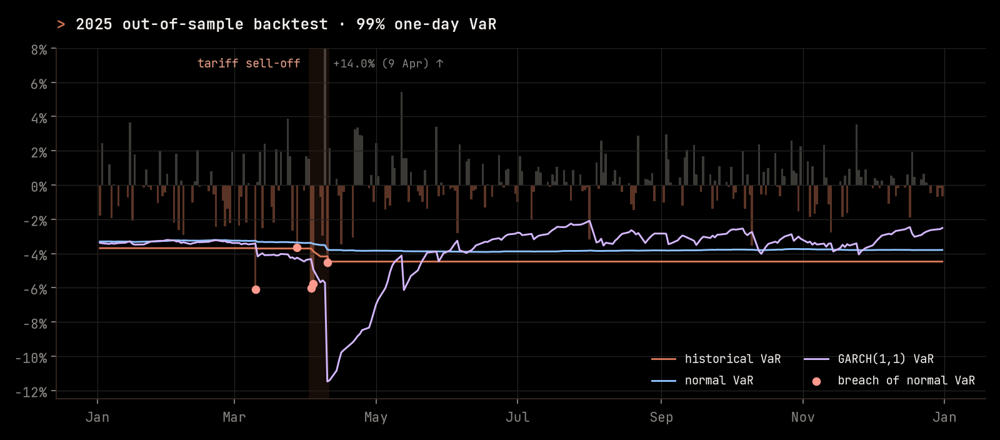
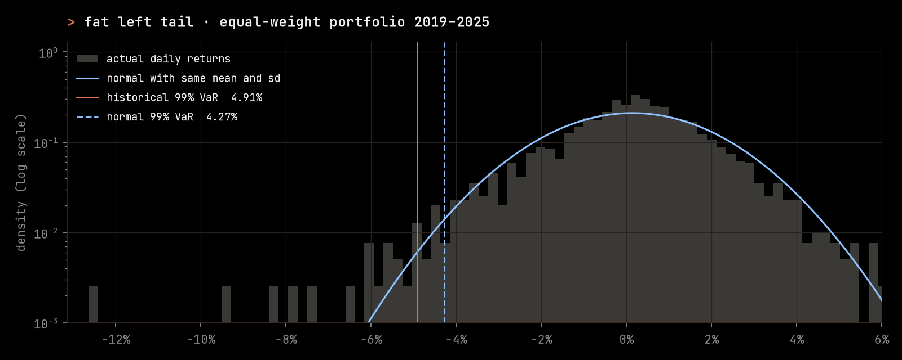
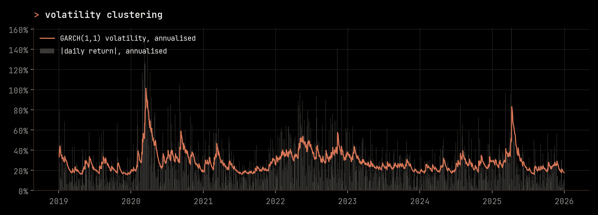

A simple Value at Risk (VaR) tester for an equal-weight portfolio of five stocks: AAPL, GOOGL, MSFT, TSLA and AMZN.

VaR estimates how much the portfolio could lose in a day. A 99% VaR of 4% means it should only lose more than 4% on about 1 day in 100. A day when it loses more is called a breach.

## Methods

- **Historical simulation:** uses the actual past returns.
- **Normal:** assumes returns follow a normal distribution.
- **Monte Carlo:** simulates 10,000 normally distributed returns.
- **GARCH(1,1):** lets volatility change from day to day.

## Backtest on 2025

I tested each method on every trading day of 2025. Each day's VaR only uses the 500 trading days before it.

| method | 95% breaches (expected 12.5) | 99% breaches (expected 2.5) |
|---|---:|---:|
| historical simulation | 21 | 4 |
| normal | 19 | 5 |
| Monte Carlo | 19 | 5 |
| GARCH(1,1) | 15 | 5 |

**Backtest graph: 2025 returns against each method's 99% VaR**



Every method had about twice as many breaches as expected at 99%.

In the April 2025 tariff sell-off, the portfolio lost 6.02% on 3 April and 5.76% on 4 April. All four methods were breached on both days. GARCH's 99% VaR then rose from 4.33% to 11.48% by 10 April, so it reacted to the volatility, but only after the first losses.

## Other graphs (full 2019–2025 data, not the backtest)

**Normal VaR understates the tail**

At 99%, historical VaR is 4.91% and normal VaR is 4.27%.



**GARCH(1,1) volatility**



## Limits

This is a simple test: five stocks, equal weights, no trading costs and only one year of backtesting. With only 2.5 breaches expected at 99%, one year isn't enough to prove a model wrong.

The clustered breaches in April are why I'd look at Extreme Value Theory next.

## Run it

```bash
pip install -r requirements.txt
python main.py
python main.py --figures   # redraw the graphs
```

---

MIT licence
